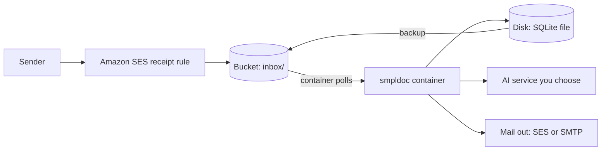
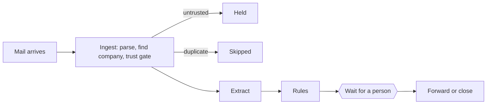

# Architecture

**Status: design.** Nothing here is built yet. This page is the plan that the first code is
written against, with tests first.

## The shape

One container runs the whole pipeline. It talks to the outside world only through **adapters**,
small modules behind fixed interfaces. The core never imports a cloud library.

| Piece | What it does | Who owns it |
|---|---|---|
| Bucket | Holds incoming raw mail under `inbox/`, original documents, and database backups | You |
| Disk | Holds the SQLite database file | You |
| Container | Reads the inbox, runs each job through the pipeline, serves the portal | This project's signed image |
| AI service | Reads documents. Optional | You |
| Mail out | Forwards a finished job. Optional | You |

The minimum you set up on AWS is: a verified domain with an MX record to SES, one bucket and one
SES receipt rule, a place to run the container with a disk, and a role that lets the container use
the bucket, send mail and call the AI service. Other clouds are a second set of adapters with the
same interfaces.

## Ports and adapters

| Port (interface) | Adapters planned |
|---|---|
| `MailIn`: a raw message appears, hand it over | `s3-inbox` (first), `imap` (second) |
| `MailOut`: send a message | `ses-send`, `smtp` |
| `Extractor`: read a document, return field values | `bedrock`, others later |
| `Store`: jobs, documents, field values, history | `sqlite` (first), Postgres later |
| `Blob`: original documents | `s3`, `filesystem` |

Every adapter must pass the same shared contract test for its port.

## The job pipeline

An email becomes one job. The runner moves it through these steps, retrying each with backoff and
writing a step event for every change:

The trust gate reads one normalised sender verdict (`pass`, `fail`, `unknown`). Each mail adapter
maps its source's checks to that verdict, and anything that is not `pass` is held.

## Security boundaries

- Company scoping: every record belongs to one company, and no query reads across companies.
- `domain/` imports nothing from a cloud library or an adapter. A build check fails if it does.
- Mail and attachments are data. Nothing in this project executes them.
- No telemetry, no self-update, no outbound call except to a configured service.

See [SECURITY.md](../SECURITY.md).

## Build order (tests first)

1. Shared contract tests for each port.
2. Runner behaviour: retries, resume after a crash, waiting for a person.
3. The runner must reproduce the exact step-event sequence for every pipeline path.
4. The `s3-inbox` adapter against a local S3-compatible server.
5. Company scoping.
6. The domain boundary check.
7. Container hardening checks and an image scan.
8. A local end-to-end check in Docker Compose.
9. A manual end-to-end check on AWS.
