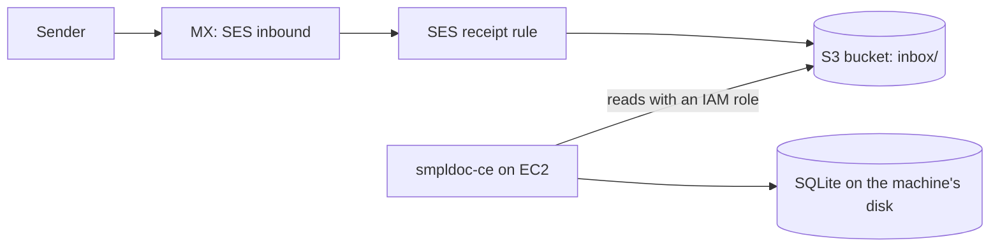

# Deploy on AWS

You bring a domain, an AWS account and one small machine. Amazon SES receives your mail and writes it to
a private S3 bucket; the smpldoc-ce container reads the bucket. **No port is opened for mail, and no
AWS keys are stored anywhere**: the container uses the machine's IAM role.



> **Status.** The mail source is built and tested (signing checked against AWS's own examples and
> against botocore, and against a local S3-compatible server). The CloudFormation template passes
> `cfn-lint` and security checks in CI, **but nobody has deployed it into a real AWS account yet**.
> Expect to report a rough edge or two, and read the template before you run it.

## Before you start

- An AWS account and the AWS CLI signed in (`aws sts get-caller-identity` works).
- A **dedicated subdomain** for mail, such as `mail.example.com`. Its MX record sends all mail for that
  name to SES, so do not use a name that already receives mail.
- A region where SES can **receive** email (see AWS's "Regions and Amazon SES" page). Receiving does not
  need SES production access; that limit is for sending.
- Docker with the Compose plugin on the machine that will run smpldoc-ce.

## 1. Create the mail stack

```bash
aws cloudformation deploy \
  --region eu-west-1 \
  --stack-name smpldoc-mail \
  --template-file deploy/aws/mail-intake.yaml \
  --capabilities CAPABILITY_IAM \
  --parameter-overrides MailDomain=mail.example.com Mailbox=acme
```

`Mailbox` is the company name smpldoc-ce files all mail for the domain under. Read the stack's outputs:

```bash
aws cloudformation describe-stacks --region eu-west-1 --stack-name smpldoc-mail --query "Stacks[0].Outputs" --output table
```

What it creates: a private encrypted bucket (kept if you delete the stack), a bucket policy that lets only
SES in your account write to `inbox/` and refuses plain HTTP, an SES domain identity and receipt rule, a
read-only IAM policy limited to the mail folders, and an EC2 instance profile and an ECS task role that
use it. Mail you have not collected expires after 30 days, collected mail after 7.

## 2. Add the DNS records

At your DNS provider for `mail.example.com`, add the records from the stack outputs:

| Type | Name | Value |
|---|---|---|
| MX | `mail.example.com` | the `MxRecord` output (priority 10) |
| CNAME x3 | the `DkimCname1-3` names | the matching values |

Wait until `aws sesv2 get-email-identity --region eu-west-1 --email-identity mail.example.com` shows
`VerifiedForSendingStatus` and DKIM `SUCCESS`.

## 3. Turn the rule set on

SES uses one active rule set per region. This replaces any active set you already have:

```bash
aws ses set-active-receipt-rule-set --region eu-west-1 --rule-set-name smpldoc-mail-rules
```

## 4. Run smpldoc-ce on a small EC2 instance

Launch the smallest instance that fits (for example a `t4g.nano` or `t4g.micro`) **with the stack's
instance profile** (`InstanceProfileName`). The container reaches the role through the instance metadata
service, which by default is one network hop away from the instance, so allow two hops and require tokens:

```bash
aws ec2 modify-instance-metadata-options --region eu-west-1 --instance-id i-0123456789abcdef0 \
  --http-tokens required --http-put-response-hop-limit 2
```

On the instance, with the repository checked out:

```bash
export SMPLDOC_S3_BUCKET=...  SMPLDOC_S3_REGION=eu-west-1  SMPLDOC_MAIL_DOMAIN=mail.example.com   # the SmpldocSettings output
docker compose -f deploy/aws/compose.yaml up -d --build
docker compose -f deploy/aws/compose.yaml run --rm smpldoc add-company acme "Your company"
```

There is no published image yet, so this builds it from the repository. The container is read-only, runs
as a non-root user with no extra capabilities, and publishes its port only on `127.0.0.1`.
Keep **one** instance running: the S3 source has no cross-process locking.

## 5. Try it

Send an email to any address at your domain (for example `hello@mail.example.com`) with a body like:

```
Invoice: 42
Total: 9.50
```

Then:

```bash
aws s3 ls s3://YOUR-BUCKET/inbox/acme/                       # arrived, until collected
docker compose -f deploy/aws/compose.yaml logs --tail 20      # one "cycle" line per poll
docker compose -f deploy/aws/compose.yaml run --rm smpldoc jobs acme
docker compose -f deploy/aws/compose.yaml run --rm smpldoc job acme JOB_ID
```

The built-in reader only understands `Name: value` lines in text; PDFs and images are stored but not read
yet. Mail whose sender fails SPF and DKIM is **held**, not processed.

## Forwarding with SES (optional)

Forwarding sends mail, which needs an SMTP server. SES provides one. In the SES console create SMTP
credentials for your region, verify the address or domain you will send from, and set:

```bash
export SMPLDOC_SMTP_HOST=email-smtp.eu-west-1.amazonaws.com SMPLDOC_MAIL_FROM=smpldoc@mail.example.com
# put the SMTP user and password in files, not on the command line (see CONFIG.md)
```

A new SES account is in the **sandbox**, which only lets you send to addresses you have verified. Request
production access before forwarding to anyone else. See [ROUTING.md](ROUTING.md) for rules and targets.

## How mail is treated

- **Trust.** The verdict comes only from the topmost `Authentication-Results` header, and only if it names
  `amazonses.com`. A header the sender wrote, or one naming another server, is ignored.
- **Nothing is deleted outright.** Collected mail moves to `processed/`; mail that is too large (over
  `SMPLDOC_MAX_MESSAGE_BYTES`) or has no mailbox folder moves to `quarantine/`.
- **Mail for a company you have not added** is collected and moved to `processed/` and not turned into a
  job. Add the company with `add-company` first; fix a mistake by moving the object back to `inbox/`.

## Settings

See [CONFIG.md](CONFIG.md): `SMPLDOC_MAIL_SOURCE=s3`, `SMPLDOC_S3_BUCKET`, `SMPLDOC_S3_REGION`,
`SMPLDOC_MAIL_DOMAIN`, and the optional `SMPLDOC_S3_PREFIX`, `SMPLDOC_S3_ENDPOINT` (an S3-compatible
server, https or loopback only), `SMPLDOC_S3_AUTHSERV_ID` and `SMPLDOC_MAX_MESSAGE_BYTES`. Credentials come
from the environment's role. For a local trial you may set `AWS_ACCESS_KEY_ID` and
`AWS_SECRET_ACCESS_KEY`, but prefer a role.

## Cost

You pay AWS directly: SES inbound is billed per message, S3 for the bytes you hold (kept small by the
expiry rules), and the machine. A single small instance is the cheapest shape. Check current prices.

## Running on ECS instead

Use the stack's `TaskRoleArn` as the task role and set the same `SMPLDOC_*` environment variables. The
container finds the role through the ECS credentials address by itself. Give the task a persistent volume
for `/data` (an EBS volume; SQLite should not live on a network file system) and keep the desired count at 1.

## Troubleshooting

| You see | Likely cause |
|---|---|
| `no AWS credentials` in the logs | Instance profile not attached, or the metadata hop limit is still 1 |
| `S3 refused the credentials (403)` | Wrong bucket or region setting, or the role is not the stack's |
| Nothing in `inbox/` | MX not live yet, rule set not active, or the domain identity is not verified |
| Mail sits in `quarantine/` | It was too large, or `inbox/` had no mailbox folder: the stack's rule sets one |
| Job is `held` | The sender failed SPF and DKIM, so it was not trusted |
| Mail went to `processed/` with no job | The company in the key was not added with `add-company` |

## Remove it

`aws cloudformation delete-stack --stack-name smpldoc-mail`. The bucket is kept on purpose (it may hold
your mail); empty and delete it yourself when you are sure. Also remove the MX and CNAME records.
