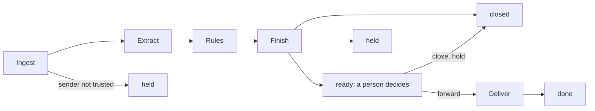

# Rules and forwarding

Each email becomes a job. After the documents are read, the job's **rules** decide what happens next, and a
job can be **forwarded** to a named address. There is no portal yet, so you manage all of this with commands.

## The life of a job



| Status | Meaning |
|---|---|
| `received`, `extracting` | In progress. A restart picks them up again |
| `ready` | Read, waiting for a person (or a rule moved it here) |
| `held` | Not processed: the sender was not trusted, or a rule held it |
| `closed` | Put away |
| `done` | Forwarded |
| `failed` | A step failed after its retries (for example a document could not be read) |

`python -m smpldoc jobs COMPANY` lists jobs; `job COMPANY JOB_ID` shows one with its values and step history.

## Rules

A rule is a **name**, **1 to 10 conditions** and **one move**. A condition is a field and a regular expression
(case-insensitive, at most 200 characters). **Every condition must match.**

| Field | Matched against |
|---|---|
| `from` | the sender |
| `to` | the address the mail arrived on |
| `subject` | the subject |
| `body` | the message text (first 20,000 characters) |
| `filename` | any attachment's file name |
| `format` | any attachment's mime type **or** file extension (`pdf`, `xlsx`, `application/pdf`) |

Moves: `review` (leave it ready for a person), `hold`, `close`, or `forward:TARGET`.

When the rules run:

- **No rule matches:** the job is `ready`.
- **One or more match and agree** (the same move): that move is made.
- **Matches disagree:** nothing moves and the job is flagged `[needs review]`. Pick a winner with `resolve`, or
  clear the flag with `resolve ... none`.
- **A rule cannot be evaluated** (it timed out): the job is `ready` and the history says why. A rule problem never loses a job.

```bash
python -m smpldoc rule-add acme "Invoices" forward:accounts subject=invoice format=pdf
python -m smpldoc rule-add acme "Newsletters" close from=newsletter@ subject='unsubscribe|digest'
python -m smpldoc rules acme                       # list, with ids
python -m smpldoc rule-disable acme RULE_ID        # also rule-enable, rule-delete
```

A company can have at most 50 rules. Patterns that can make matching explode are refused when you save
them: nested repeats like `(a+)+`, alternation inside a repeat like `(a|b)+`, repeated look-arounds and
back-references. Evaluation also runs in a separate process with a two-second limit, so a pattern that is
slow anyway can only fail that one job's rules, never freeze the service.

## Forwarding

Forwarding sends an email: a short summary (who, subject, file names, the extracted values and the original
text) with the original attachments. **A job can only be forwarded to a target you created**, so a rule or a
mistaken command can never send mail to an arbitrary address.

```bash
python -m smpldoc target-add acme accounts ap@example.com
python -m smpldoc targets acme
python -m smpldoc job-action acme JOB_ID forward accounts     # or let a rule forward it
```

Sending needs an SMTP server (see [CONFIG.md](CONFIG.md): `SMPLDOC_SMTP_HOST`, `SMPLDOC_MAIL_FROM` and the
rest). Any SMTP service works, including Amazon SES, Microsoft 365, Gmail and Postmark. TLS is required.

- A **temporary** failure (the server is busy or unreachable) is retried three times with backoff.
- A **permanent** failure (the address is refused, bad credentials, too large) is not retried. The job stays
  `ready` with the error shown by `jobs`, and you can fix the cause and forward it again.
- The message is capped (default 10 MB and 32 files, `SMPLDOC_MAX_FORWARD_BYTES`); a bigger job fails with a
  clear error rather than being sent partly.
- If no SMTP server is configured, a forward fails with `NotConfigured` and nothing is lost.

## Person moves

`python -m smpldoc job-action COMPANY JOB_ID ACTION`, where ACTION is one of the moves allowed for the job's
current status. An invalid move changes nothing and lists what is allowed.

| Action | From | To |
|---|---|---|
| `review` | received, held, failed | ready |
| `hold` | received, ready, failed | held |
| `close` | received, extracting, ready, held, failed | closed |
| `reopen` | closed | ready |
| `reprocess` | any except received | extracting (extract and rules run again; values are replaced) |
| `forward TARGET` | ready | ready, then `done` once sent |

A forward you queue is sent by the running service within its poll interval.
